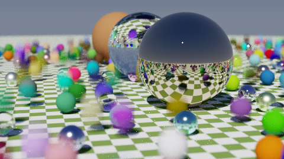

# riow-rs

A personal raytracer in Rust, based on the
[_Ray Tracing in One Weekend_](https://raytracing.github.io/books/RayTracingInOneWeekend.html)
series (v4.0.2) by Peter Shirley, Trevor David Black and Steve Hollasch.



## Running

```sh
cargo run --release
```

The rendered image is written to `image.png` in the project root. Rendering is
parallelised with Rayon; progress and total render time go to stderr.

Renders are reproducible: scene construction and every image row are seeded
from `common::DEFAULT_SEED`, so the same seed always produces the same image,
regardless of thread scheduling.

## Scenes

Pick a scene with `SCENE` in `src/main.rs` (1–10):

| #  | Scene               | Highlights                                       |
|----|---------------------|--------------------------------------------------|
| 1  | `bouncing_spheres`  | diffuse/metal/glass, motion blur, depth of field |
| 2  | `checkered_spheres` | checker texture                                  |
| 3  | `earth`             | image texture (`earthmap.jpg`)                   |
| 4  | `perlin_spheres`    | Perlin noise texture                             |
| 5  | `quads`             | quads                                            |
| 6  | `triangles`         | triangles (a tetrahedron)                        |
| 7  | `simple_light`      | emissive materials, importance sampling          |
| 8  | `cornell_smoke`     | participating media with forward scattering      |
| 9  | `cornell_box`       | Cornell box with rotated metal/white boxes       |
| 10 | `final_scene`       | everything combined                              |

Scenes 8–10 take `(image_width, samples_per_pixel, max_depth)` at the call
site. Every other camera knob lives in `CameraSettings` (see
`src/camera.rs`), so a scene only overrides what it needs.

Sample counts are the main quality/speed dial: indirect light converges as
`1 / sqrt(samples)`, so a scene like the Cornell box needs a few hundred
samples per pixel to look clean (10 spp is a fast, noisy preview). Lower the
counts in `src/main.rs` while iterating, raise them for final renders.

## Features

- **Materials**: Lambertian, GGX microfacet metal with Schlick Fresnel,
  dielectric (glass) with total internal reflection, emissive, isotropic and
  Henyey-Greenstein volumetric media
- **Textures**: solid color, checker, image (sRGB-decoded), Perlin noise
- **Primitives**: spheres (including moving), quads, triangles, boxes,
  constant-density media
- **Instance transforms**: translation and y-rotation
- **BVH acceleration** over all objects
- **Lighting**: area lights plus an optional procedural sky with a sun disk;
  next-event estimation with balance-heuristic MIS between lights, the sun
  and the material BSDF
- **Path tracing**: Russian roulette, jittered stratified pixel samples
- **Camera**: thin-lens depth of field, motion blur, exposure control, ACES
  tone mapping, sRGB output

## Layout

```
src/
├── main.rs            entry point and scene selection
├── scenes.rs          the ten demo scenes
├── camera.rs          camera model, render loop, estimator
├── background.rs      uniform backgrounds and the procedural sky
├── vec3.rs            vector math
├── color.rs           sRGB transfer curves and tone mapping
├── interval.rs        ray parameter ranges and bounding-box slabs
├── ray.rs             rays
├── aabb.rs, bvh.rs    bounding boxes and BVH acceleration
├── hittable.rs        Hittable trait, HitRecord, transforms
├── hittable_list.rs   object lists
├── plane.rs           plane math shared by quads and triangles
├── quad.rs            parallelograms and boxes
├── triangle.rs        triangles
├── sphere.rs          spheres
├── constant_medium.rs participating media
├── material.rs        materials and BSDFs
├── texture.rs         textures
├── pdf.rs             sampling densities (cosine, GGX, HG, lights)
├── perlin.rs          Perlin noise
└── rtw_image.rs       image loading
```
